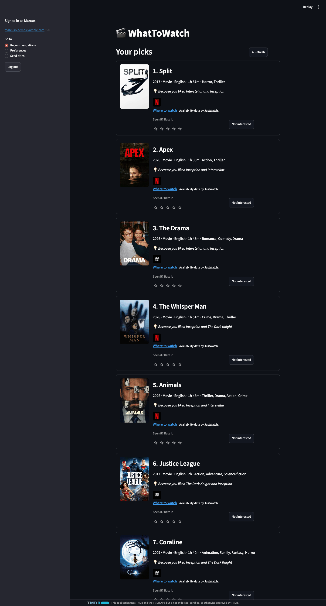
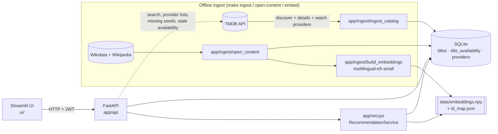
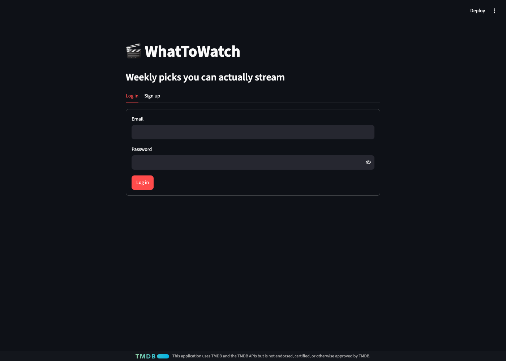
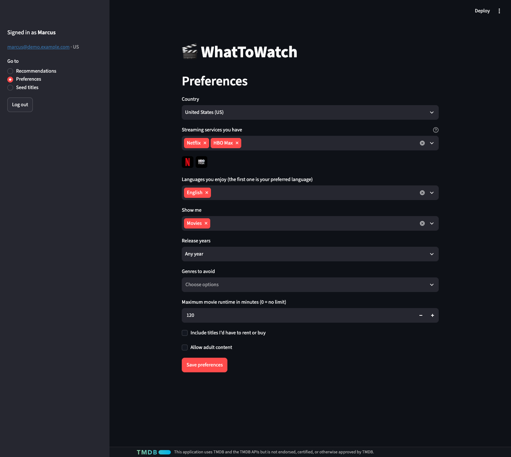

# WhatToWatch

*Less scrolling, more watching.*

I love watching movies and series. What I don't love is the 45 minutes I spend *before* watching anything: opening Netflix, scrolling, switching to Prime, scrolling some more, checking whether that show everyone talks about is even on a service I pay for, and finally rewatching something I've already seen five times because by then it's late.

Having several streaming subscriptions was supposed to mean more choice. In practice it meant more browsing.

So I built WhatToWatch. You tell it a few things you've loved, which streaming services you have and where you live, and it gives you **10 picks you'll probably enjoy and can start watching right now**, on a service you already pay for. No "sorry, not available in your region." No trailers for things you can't watch.



## How it works (the short version)

1. **Tell it your taste.** Pick 3 to 10 movies or shows you loved. *3 Idiots*, *Parasite*, *Interstellar*: anything goes.
2. **Tell it your services.** Netflix, Prime Video, Max, JioHotstar, whatever you have in your country.
3. **Set your rules.** Languages you enjoy, movies vs. series, how old is too old, how long is too long, genres you'd rather avoid.
4. **Get 10 picks.** Each comes with the reason it was picked ("Because you liked …") and the logos of the services it's on.
5. **Keep telling it what you think.** Rate a pick or hit "Not interested" and the list updates. The more you rate, the better it gets.

Under the hood it finds titles that are *about* similar things to what you loved (using descriptions from Wikipedia and Wikidata), throws out anything that breaks your rules or that you can't stream, and mixes up the list so you don't get ten near-identical thrillers.

> **Status: Phase 1 (local MVP), v0.1.0.** It runs on your laptop: sign up, set preferences, pick seed titles, get 10 recommendations you can actually stream.

## Getting started (fresh clone)

Grab some popcorn; the first catalog build takes a while.

Requires [uv](https://docs.astral.sh/uv/) and `make`. uv installs Python 3.12 itself. The ML dependency group (sentence-transformers + PyTorch, about 1 GB) is installed the first time you run `make embed` / `make api`.

### 1. Install

```bash
make install   # venv + deps + pre-commit hooks; creates .env from .env.example
```

### 2. Get a TMDB key

The catalog, posters, provider lists and availability come from [TMDB](https://www.themoviedb.org/) (non-commercial use).

1. Create a free account at [themoviedb.org](https://www.themoviedb.org/signup) and verify your email.
2. Open **Settings → API** ([themoviedb.org/settings/api](https://www.themoviedb.org/settings/api)) and request a **Developer** key (personal / non-commercial use).
3. Copy the **API Read Access Token** (the long JWT) into `.env` as `TMDB_READ_TOKEN=...`. The short **API Key** also works as `TMDB_API_KEY=...`; you need only one of the two.

### 3. Set the Wikimedia contact

The recommender's item content comes from Wikidata and Wikipedia (see [Open content and embeddings](#open-content-and-embeddings)). Wikimedia's User-Agent policy asks for a way to reach you, so set `WIKIMEDIA_CONTACT` in `.env` to your email or a URL.

### 4. Build the catalog and run the app

```bash
make ingest          # TMDB catalog → titles, availability, providers (runs `make migrate` first)
make open-content    # Wikidata + Wikipedia descriptions for catalog titles
make embed           # embedding index → data/embeddings.npy (+ id_map.json, embeddings_meta.json)
make api             # http://127.0.0.1:8000/api/v1/health  ·  docs at /docs
make ui              # in a second terminal: http://localhost:8501
```

A full ingest pages through 9 languages × movie/TV and takes a while. For a quick first run use `make ingest ARGS="--limit 200 --pages 1"` and `make open-content ARGS="--limit 200"`. Every step can be re-run safely.

### 5. Optional: demo users

```bash
make seed-demo                                      # in-process API, no server needed
make seed-demo ARGS="--api-url http://127.0.0.1:8000"   # or against a running `make api`
```

Meet the cast: three demo viewers with very different taste. The script creates them through the public API, onboards them fully and prints each one's first recommendations. Log in at the UI with any of them; the password is `whattowatch-demo`.

| User | Country | Languages | Services | Seeds |
|---|---|---|---|---|
| `priya@demo.example.com` | IN | hi, en, ko | Netflix, Amazon Prime Video, JioCinema / JioHotstar | 3 Idiots, Parasite, Interstellar |
| `marcus@demo.example.com` | US | en (movies only, < 2 h) | Netflix, Max / HBO Max | The Dark Knight, Inception, Interstellar |
| `ji-woo@demo.example.com` | KR | ja, ko | Netflix + free tiers (Crunchyroll, Laftel, TVING where TMDB lists them) | Spirited Away, Your Name., Squid Game, My Neighbor Totoro, Akira |

Services are matched by name in the country's TMDB provider list; a service TMDB doesn't list there is skipped and reported. Re-running logs into the existing accounts and re-applies their preferences without adding duplicate seed ratings. Priya and Ji-woo need TMDB credentials (the IN and KR provider lists and availability are fetched on demand). The script refuses to run with `APP_ENV=prod`.

## Make targets

| Target | Purpose |
|---|---|
| `install` | Install dependencies (default + `dev` group) and git hooks; create `.env` from `.env.example` |
| `lint` / `fmt` | Ruff lint + format check / auto-fix |
| `typecheck` | `mypy --strict` on `app/` |
| `test` | `pytest` (with the `ui` group) plus the coverage gate: ≥ 60% on `app/recsys` (`RECSYS_COV_MIN`) |
| `migrate` | Apply Alembic migrations to `DATABASE_URL` (`alembic upgrade head`); `ingest`, `api` and `seed-demo` run it first |
| `ingest` | TMDB catalog ingest into `titles`, `title_availability`, `providers` (pass flags via `ARGS=...`) |
| `open-content` | Wikidata + Wikipedia content for catalog titles into `title_open_content` (`ARGS="--limit 200"`) |
| `embed` | Build embeddings from open content, uses the `ml` dependency group (`ARGS="--incremental"`) |
| `api` | FastAPI dev server (with the `ml` group, so new seed titles are embedded on the fly) |
| `ui` | Streamlit UI at http://localhost:8501 (needs `make api` running) |
| `seed-demo` | Demo users Priya / Marcus / Ji-woo, onboarded through the API (`ARGS="--api-url URL --only priya --no-recs"`) |
| `neighbours` | Print nearest neighbours for known titles (embedding sanity check) |
| `bench-recs` | Recommender latency on a synthetic 15k-title catalog (p50 / p95) |

## Architecture

Nothing fancy, on purpose. A modular monolith: one FastAPI process, offline ingest scripts and a Streamlit UI that talks to the API only over HTTP.



**Packages** (they talk only through these interfaces; `recsys` never imports `api`, and `ui` imports nothing from `app`):

| Package | Role |
|---|---|
| `app/api` | HTTP endpoints under `/api/v1`: auth (JWT), profile, preferences, providers, title search, onboarding seeds, interactions, recommendations. Errors are RFC 9457 problem+json. |
| `app/recsys` | The recommender (§8 of the spec). `service.py` is the only module that touches the DB; the steps are pure functions. |
| `app/ingest` | TMDB and Wikimedia clients (timeouts, retries with backoff, rate limits) and the three offline CLIs. |
| `app/db` | SQLAlchemy 2.0 models and Alembic migrations (portable to Postgres in Phase 2). |
| `app/core` | Settings (`pydantic-settings`), structured JSON logging with request IDs, security (Argon2, JWT key rotation). |
| `ui` | Streamlit app + a small `httpx` API client. |

**Recommendation pipeline** (`GET /api/v1/recommendations`), or how a whole catalog becomes 10 picks:

```
profile (time-decayed mean of liked-title vectors)
  → hard-filter mask (languages, type, era, runtime, adult, already seen / not interested)
  → candidates (top-500 by cosine similarity + top-100 trending)
  → score (similarity + recency)
  → availability (only titles streamable on the user's services in their country)
  → MMR diversity re-rank with per-language / per-genre caps
  → template reason ("Because you liked …")
```

New users with no ratings yet aren't left staring at an empty screen: they get a cold-start list (popular titles that pass the same filters and availability check). The ML layer's item content comes only from Wikidata and Wikipedia; TMDB data is used for display, filters and availability (FEATURE_SPEC D-011).

## Screenshots

| Sign up / log in | Preferences | Recommendations |
|---|---|---|
|  |  |  |

## Testing

`make lint typecheck test`. No real APIs were harmed in the making of this test suite. Tests never call TMDB, Wikimedia or an LLM; HTTP is mocked with `respx`, and recorded TMDB responses live under `tests/fixtures/tmdb/`. Recommender tests run on a deterministic ~200-title fixture catalog with fake embeddings (`tests/recsys_catalog.py`). The Streamlit UI is tested end to end with Streamlit's `AppTest` against the real API in-process. `make test` fails if coverage of `app/recsys` drops below 60%.

## Database

SQLAlchemy 2.0 models live in `app/db/models/`, migrations in `app/db/alembic/versions/`. Run `make migrate` after pulling (`make ingest`, `make api` and `make seed-demo` also run it). To add a migration after changing models: `uv run alembic revision --autogenerate -m "<what>"`, then review the generated file (views such as `ratings` are hand-written, never autogenerated). `uv run alembic check` confirms models and migrations agree.

## Catalog ingest

Needs `TMDB_READ_TOKEN` or `TMDB_API_KEY` in `.env` ([how to get one](#2-get-a-tmdb-key)). Migrations run first automatically.

```bash
make ingest ARGS="--limit 200 --pages 1"   # fast smoke run
make ingest                                 # full run: SEED_LANGUAGES x movie/tv, INGEST_PAGES_PER_LANGUAGE pages
make ingest ARGS="--resume"                 # continue an interrupted run (skips titles updated in the last 24 h)
```

Other flags: `--languages en ko`, `--types movie tv`, `--countries US IN`, `--fresh-hours H`, `--batch-size N`. Re-running is safe: rows are upserted by primary key and availability is replaced for the chosen countries.

## Open content and embeddings

The ML layer's item content comes only from openly licensed sources: Wikidata (CC0) and Wikipedia (CC BY-SA 4.0). TMDB IDs are used only to join them to the catalog; no TMDB text goes into the embeddings (FEATURE_SPEC D-011).

Set `WIKIMEDIA_CONTACT` in `.env` (an email or URL where Wikimedia can reach you; their User-Agent policy requires it). `make open-content` refuses to run without it.

```bash
make open-content ARGS="--limit 200"   # smoke run; prints a coverage table by language x type
make open-content ARGS="--resume"      # skip titles fetched in the last 24 h
make embed                             # full build → data/embeddings.npy, id_map.json, embeddings_meta.json
make embed ARGS="--incremental"        # embed only titles missing from the id map
make neighbours                        # nearest neighbours for Inception, Attack on Titan, Parasite
make neighbours ARGS='--title "Spirited Away" -k 5'
```

The API loads the index at startup; `GET /api/v1/ready` returns 503 until it is loaded, so run `make embed` before `make api`.

Only titles with a Wikipedia summary are embedded. `make embed` runs with the `ml` dependency group (sentence-transformers, `intfloat/multilingual-e5-small`, downloaded on first use). On Intel Macs the ML stack is pinned to PyTorch 2.2.2 / NumPy 1.26, the last versions with x86_64 macOS wheels.

## Streamlit UI

`make ui` starts the Phase 1 UI (`ui/streamlit_app.py`). It talks to the API only over HTTP through `ui/api_client.py` (it never imports `app.*`; a test enforces this) and keeps the access token in the Streamlit session. The API address comes from `API_BASE_URL` (environment variable, else `.env`, else `http://localhost:8000`).

Before the first run you need a catalog and an embedding index (`make ingest open-content embed`), TMDB credentials in `.env` (title search and provider lists), then `make api` and `make ui`.

Screens: sign up / log in → preferences (country, streaming services, languages, type, era, genres to avoid, max runtime, rent/buy, adult) → seed titles (search, pick 3 to 10) → 10 recommendation cards with star ratings and "Not interested" (both refresh the list). After onboarding, the sidebar switches between recommendations, preferences and adding more seed titles. Every screen shows the TMDB logo and notice in a fixed footer.

Title search runs when you press Enter or **Search**, not on every keystroke, so each query is one TMDB call (results are also cached for the session).

### Manual QA checklist

Run with a real catalog (`make api`, `make ui`), in a fresh browser session:

- [ ] Logged-out screen, preferences, seed picker and recommendations all show the TMDB logo + exact notice in the footer; the logo is much smaller than the "WhatToWatch" title and never in the header.
- [ ] Sign up with an existing email (any case) shows "An account with this email exists."; a wrong password at login shows the generic error.
- [ ] Preferences: the service list follows the chosen country and shows logos for the selected services; saving with no type selected is blocked.
- [ ] Changing country on the preferences screen and saving shows which services were removed.
- [ ] Seeds: searching "parasite" finds the 2019 film, "squid" finds Squid Game; "Get my recommendations" stays disabled below 3 picks; at 10 picks "Add" is disabled; ✕ removes a pick.
- [ ] Seeds without an open description show a note that they don't shape recommendations yet.
- [ ] Cards show poster, localized + original title, year, type, language, runtime or seasons, genres, provider logos (each opens the TMDB watch page), the reason, and "Availability data by JustWatch.".
- [ ] Rating a card or pressing "Not interested" removes it and refreshes the list; "Refresh" reloads it.
- [ ] Stopping the API shows "Could not reach the WhatToWatch API" instead of a crash; an expired token sends you back to log in.
- [ ] Time a new user from the sign-up screen to the first recommendations (target < 3 minutes).

## Configuration

All settings live in `app/core/config.py` and are read from environment variables or `.env`. Every key is listed in `.env.example`.

---

This application uses TMDB and the TMDB APIs but is not endorsed, certified, or otherwise approved by TMDB.

Availability data by JustWatch.

Title descriptions include text from Wikipedia, available under the Creative Commons Attribution-ShareAlike 4.0 License ([CC BY-SA 4.0](https://creativecommons.org/licenses/by-sa/4.0/)). Structured data from [Wikidata](https://www.wikidata.org/) (CC0).
